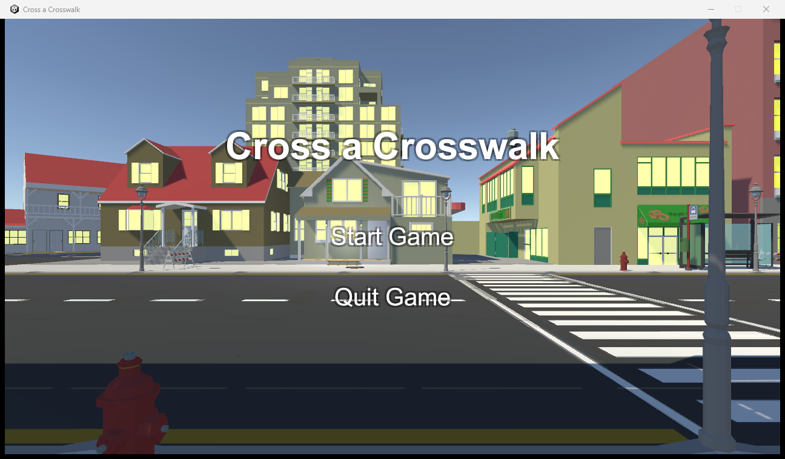

# Cross A Crosswalk

안전하게 횡단보도를 건너는 게임. 시뮬레이션 · PC (Unity 학습 프로젝트).

## 플레이

[Releases](../../releases)에서 `CrossACrosswalk-<버전>-windows.zip`을 받아 압축을 풀고 `Cross a Crosswalk.exe` 실행. Windows x64.

WASD로 이동하고 Q, E로 몸을 기울이고 마우스 클릭으로 손을 들거나 멀리 볼 수 있습니다.
신호에 주의하여 안전히 횡단보도를 건너면 클리어할 수 있습니다.

## 제작 노트

이전에 만든 Dungeon Alchemist에 심력이 많이 쏟아 쉬어가는 시간으로 제작한 게임입니다.
횡단보도를 안전하게 건너는 교육 게임처럼 소개하고, 반댓편 신호가 고장나거나 모든 신호가 고장나서 멀리 있는 차량 신호를 봐야 하는 등의 요소를 넣으면 재미있겠다는 구상으로 제작하였습니다.
